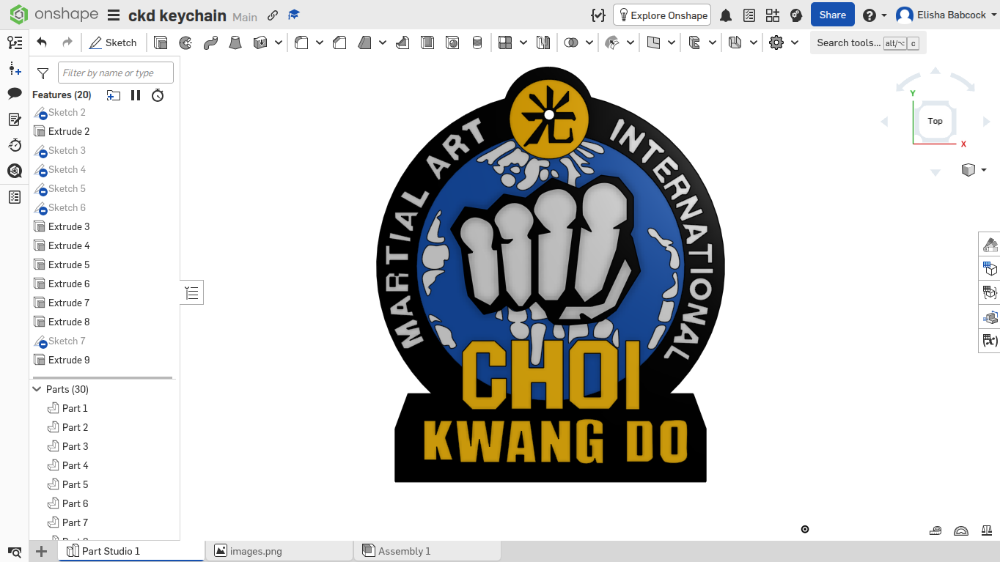

# 🥋 Choi Kwang Do International Logo Keychain

## 🔍 What is this?
This project is a custom **3D digital CAD model** of a keychain featuring the official logo of **Choi Kwang Do (CKD)** martial arts. It serves as a high-fidelity 3D asset that can be used for digital renderings, design portfolios, or future manufacturing methods.

## 🎯 Why you built this?
I created this project to practice advanced 2D-to-3D sketching, geometric constraints, and logo extrusion within a professional cloud-CAD environment. It bridges digital design with martial arts appreciation, providing a clean, multi-layered asset of the Choi Kwang Do emblem.

## 🛠️ Tools you used
*   **CAD Modeling:** [Onshape](https://onshape.com) — Used for layout, sketching, and exporting precision 3D solids.

---

### 🌐 Onshape Workspace Link
👉 [View the live CAD model here](https://onshape.com)

### 📁 Repository Guide
*   📁 **`CAD/`**: Contains the exported precision 3D files (`.step` and `.stl`).
*   📁 **`Production/`**: Contains `BOM.csv` (Bill of Materials) documenting project metadata or digital item details.

